<div align="center">



**Estudiante de ingeniería · Desarrollo de software · Análisis de datos**

<sub>📍 Perú &nbsp;·&nbsp; 💻 Aprendiendo en público &nbsp;·&nbsp; 🎯 De la idea al proyecto</sub>

<br />

<a href="https://github.com/diegoALE-dev?tab=repositories"></a>
<a href="https://github.com/diegoALE-dev"></a>

</div>

---

### 👋 Un poco sobre mí

¡Hola! Soy **Diego**. Me gusta entender **por qué sucede un problema** antes de pensar en cómo programar su solución. Disfruto aprender nuevas herramientas, experimentar con ideas y transformar lo que estudio en proyectos que pueda explicar, mejorar y compartir.

Mi curiosidad se mueve entre el **desarrollo de software**, el **análisis de datos**, los **algoritmos** y la parte menos visible de la tecnología: **Linux, contenedores e infraestructura**.

> **Mi filosofía:** aprender haciendo, documentar el proceso y mejorar una versión a la vez.

- 🔭 **Actualmente:** construyo proyectos de programación y exploro aplicaciones web y proyectos relacionados con datos.
- 🧠 **Me entusiasma:** conectar lo que aprendo en clase con problemas reales.
- 📚 **Estoy profundizando en:** POO, estructuras de datos, bases de datos y buenas prácticas de desarrollo.
- 🛡️ **También exploro:** fundamentos de ciberseguridad, identidad y herramientas DevOps.

### 🧰 Mi caja de herramientas

No todo está al mismo nivel: estas son tecnologías que **uso en proyectos y prácticas**, junto con otras que continúo estudiando.

**Lenguajes y desarrollo**


**Datos y análisis**


**Entorno y herramientas**


### 🚀 Proyectos destacados

#### 🎮 [Gesture Runner](https://github.com/diegoALE-dev/Gesture-Runner)

**TypeScript · Canvas 2D · MediaPipe**

Un juego de plataformas que explora una idea divertida: **controlar el personaje con gestos captados por la webcam**. El prototipo incluye controles por gestos y teclado; la parte de entrenamiento de modelos está planteada como una evolución futura.

#### 🌦️ [DataLex Perú — Analizador léxico](https://github.com/diegoALE-dev/Trabajo-Parcial)

**Python · Análisis léxico · Pruebas**

Proyecto académico que transforma expresiones de un pequeño lenguaje de consulta sobre **datos climáticos** en tokens identificables. Incluye validaciones, pruebas y documentación del alcance implementado.

#### 🗂️ [Mesa de Partes Digital](https://github.com/diegoALE-dev/Desafio-final)

**C# · .NET · Algoritmos · Archivos de texto**

Prototipo académico de consola orientado a digitalizar el manejo de expedientes. Me ha permitido trabajar la organización del código, el tratamiento de datos y la lógica necesaria para registrar y consultar información.

### 🧪 En mi laboratorio de aprendizaje

Además de mis repositorios públicos, he practicado con un **sistema de farmacia en Python**, un **analizador de registros de firewall** y ejercicios de **programación orientada a objetos**. Me interesa publicar versiones cada vez mejor documentadas de estas prácticas.

### 🧭 Hacia dónde voy

```text
idea
  └── entender el problema
        └── diseñar una solución
              └── construir un prototipo
                    └── probar y mejorar
                          └── compartir lo aprendido
```

Quiero seguir creciendo en el desarrollo de software, fortalecer mi pensamiento analítico y crear proyectos donde **los datos y el código ayuden a resolver problemas concretos**.

---

<div align="center">

**Gracias por pasar por aquí.** ✨

<sub>Siempre hay algo nuevo por aprender · <a href="https://github.com/diegoALE-dev?tab=repositories">Explora mis repositorios</a></sub>

</div>


